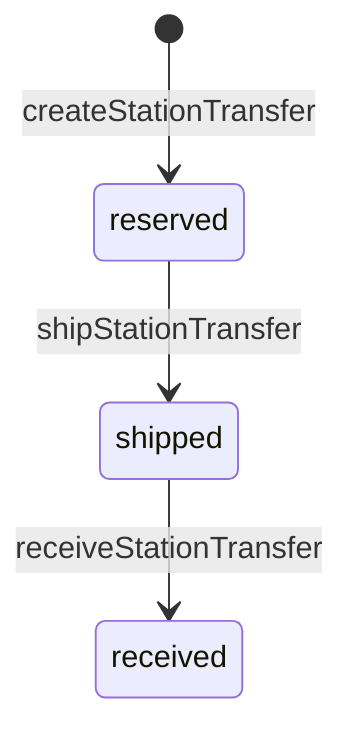

# OFFICE001 → S001/S002：UI 串接規格

本文件依目前程式碼整理，範例 ID、時間、名稱及庫存數字是示意，未查詢或修改正式資料庫。
本次只新增文件，未修改 Flutter UI 或任何業務邏輯。

## 1. 對接範圍與程式依據

- 總倉 → 收容中心：station_transfers + StationTransferService。
- 收容中心 → 災民：supply_requests + SupplyRequestService，維持既有 requestId / volunteerId / stationId 流程。
- 舊 allocations：inventory 總庫存分配與出貨，不自動轉成新調度單。
- 後端路由：`../bin/admin_server.dart` 的 handleRequest() / handleStationTransfer()。
- 調度與庫存：`../lib/services/supply/station_transfer_service.dart` 的 create() / ship() / receive() / getTransfers() / getStationInventory()。
- Schema：`../lib/database/database_service.dart` 的 createStationTransferSchema()。

所有 API 使用 **POST 至同一個後端根網址**，以 JSON 的 type 分流。
本機例 `http://localhost:8080`；Flutter 請沿用 ApiConfig.baseUrl，不自行組 `/createStationTransfer` 等路徑。
Header：`Content-Type: application/json`；經 ngrok 時可沿用既有 `ngrok-skip-browser-warning: true`。

成功都是 HTTP 200：`success: true`；失敗需同時處理 HTTP 狀態與 JSON message。
Station Transfer 動作及查詢回應包含 success / message / data。
getStations 的成功回應只有 success / data，不要強制要求 message。

## 2. 建立：createStationTransfer

| 參數 | 必填 | 型別與規則 |
|---|---|---|
| type | 是 | `createStationTransfer` |
| fromStationId | 否 | 字串；省略時 OFFICE001，若提供只能是 OFFICE001，不能是 null／空字串 |
| toStationId | 是 | 非空字串，限 S001 或 S002，且必須存在、type=shelter |
| itemId | 是 | JSON 正整數，物資必須存在；不可傳字串 `"1"` 或小數 |
| qty | 是 | JSON 正整數，來源可用庫存必須足夠 |
| createdBy | 是 | 非空字串；現階段為紀錄欄位，不代表後端已驗證身分 |

```json
{
  "type": "createStationTransfer",
  "fromStationId": "OFFICE001",
  "toStationId": "S001",
  "itemId": 1,
  "qty": 10,
  "createdBy": "admin_ncnu"
}
```

HTTP 200：

```json
{
  "success": true,
  "message": "調度已建立，來源庫存已預留",
  "data": {
    "transferId": "7f52c8a1-b63d-4e90-8a21-109a702ca901",
    "fromStationId": "OFFICE001",
    "toStationId": "S001",
    "itemId": 1,
    "qty": 10,
    "status": "reserved",
    "createdBy": "admin_ncnu",
    "createdAt": "2026-10-13T00:00:00.000Z",
    "shippedAt": null,
    "receivedAt": null
  }
}
```

建立回應是原始單據欄位，**沒有 itemName / unit / fromStationName / toStationName**。
可暫時使用選單的名稱顯示，接著以 getStationTransfers 刷新取得完整顯示欄位。

## 3. 出貨：shipStationTransfer

只需 type 和非空字串 transferId；不需再傳 itemId、qty、stationId 或 status。
後端從已存在單據讀取數量及據點。

```json
{
  "type": "shipStationTransfer",
  "transferId": "7f52c8a1-b63d-4e90-8a21-109a702ca901"
}
```

HTTP 200：

```json
{
  "success": true,
  "message": "已確認出貨，目的據點尚未入庫",
  "data": {
    "transferId": "7f52c8a1-b63d-4e90-8a21-109a702ca901",
    "fromStationId": "OFFICE001",
    "toStationId": "S001",
    "itemId": 1,
    "qty": 10,
    "status": "shipped",
    "createdBy": "admin_ncnu",
    "createdAt": "2026-10-13T00:00:00.000Z",
    "shippedAt": "2026-10-13T00:10:00.000Z",
    "receivedAt": null
  }
}
```

## 4. 收貨：receiveStationTransfer

只需 type 和非空字串 transferId。只有 shipped 可以收貨。

```json
{
  "type": "receiveStationTransfer",
  "transferId": "7f52c8a1-b63d-4e90-8a21-109a702ca901"
}
```

HTTP 200：

```json
{
  "success": true,
  "message": "已確認收貨，目的據點庫存已增加",
  "data": {
    "transferId": "7f52c8a1-b63d-4e90-8a21-109a702ca901",
    "fromStationId": "OFFICE001",
    "toStationId": "S001",
    "itemId": 1,
    "qty": 10,
    "status": "received",
    "createdBy": "admin_ncnu",
    "createdAt": "2026-10-13T00:00:00.000Z",
    "shippedAt": "2026-10-13T00:10:00.000Z",
    "receivedAt": "2026-10-13T00:20:00.000Z"
  }
}
```

若目的據點尚無該物資的 station_inventory 列，收貨時會新增，預留量為 0；
已有資料則只增加 stockQty，不重設原有 reservedQty。
時間由後端寫入 UTC ISO 8601，前端可轉臺灣時間顯示，不自行回傳修改時間。

## 5. transferId 與前端狀態

- 建立成功立即保存 `data.transferId`，型別是 **String UUID**。
- 後續按鈕使用該列 transferId，不用 allocationId / requestId，也不搜尋「同品項最新一筆」。
- 頁面重新開啟時用 getStationTransfers 還原，不依賴只存在本次 session 的快取。
- 建議新增 StationTransfer model；不要直接套用 AllocationItem / DispatchItem。
  這兩個舊 model 以 int ID、zoneId 和舊時間欄位解析，無法正確表示新單據。
- 建立／出貨／收貨成功後，以後端 data.status 更新該單，再刷新列表和庫存。
- 動作回應缺少顯示用名稱，若覆蓋已載入完整單據，須保留名稱或重新查列表。
- 同一張單據動作送出期間禁用該按鈕；建立送出期間也應禁用，避免建立兩張不同單據。



| status | UI 狀態名稱 | 可用動作 |
|---|---|---|
| reserved | 待出貨 | 確認出貨 |
| shipped | 運送中／待收貨 | 確認收貨 |
| received | 已收貨 | 查看紀錄；無出貨／收貨按鈕 |

新流程沒有 cancelled 狀態。前端不要提供呼叫舊 cancelAllocation 的「取消調度」。
shipped 代表離開來源，不能顯示成「目的已入庫」或「配送完成」。

## 6. 庫存變化與刷新

availableQty = stockQty - reservedQty，來源與目的都取 station_inventory。

| 階段 | OFFICE001 stock/reserved/available | S001 stock/reserved/available |
|---|---|---|
| 初始 | 50 / 0 / 50 | 20 / 5 / 15 |
| 建立 10 | 50 / 10 / 40 | 20 / 5 / 15 |
| 出貨 | 40 / 0 / 40 | 20 / 5 / 15 |
| 收貨 | 40 / 0 / 40 | 30 / 5 / 25 |

出貨後在庫總和暫時減少，這 10 個仍在運送中；收貨後才重新出現在目的據點庫存。
不要為了平衡總數而提前增加 S001，也不要在收貨時再次扣來源。

```json
{"type":"getStationInventory","stationId":"OFFICE001"}
```

目的據點用 S001／S002，同一格式。成功回應範例：

```json
{
  "success": true,
  "message": "據點庫存查詢成功",
  "data": [{
    "stationId":"OFFICE001", "itemId":1, "itemName":"泡麵", "unit":"箱",
    "stockQty":50, "reservedQty":10, "availableQty":40,
    "updatedAt":"2026-10-13T00:00:00.000Z"
  }]
}
```

建立刷新 OFFICE001；出貨刷新來源及列表；收貨刷新目的及列表。
若同時顯示兩邊，三階段都刷新兩邊最容易維持一致。
物資選擇及數量上限依 getStationInventory(OFFICE001) 的 availableQty，不能依 getInventory。
前端數量檢查只供操作提示；最終以後端交易檢查為準，因為庫存可能被其他單據預留。

## 7. 據點選單

```json
{"type":"getStations"}
```

回傳 `{"success":true,"data":[...]}`，每筆含 stationId / name / type / lat / lng / address。
下拉選單顯示 name、值為 stationId。這次目的選單僅允許 S001/S002 且 type=shelter。
不要把「A收容中心」文字當 toStationId，也不要以自由輸入 zoneId 代替。
getStations 可以回傳更多據點，不代表 createStationTransfer 已允許那些目的 ID。

## 8. 列表、詳情與狀態查詢

### 已有 getStationTransfers

```json
{"type":"getStationTransfers","stationId":"OFFICE001","status":"reserved"}
```

- stationId、status 均可省略或傳 null；提供時不可為空白／非字串。
- stationId 同時匹配 fromStationId 或 toStationId，不是只匹配目的。
- status 只接受 reserved / shipped / received，必須單一字串，不能传陣列。
- 欲查 S001 的運送中資料，傳 stationId=S001、status=shipped。
- 查 OFFICE001 並省略 status，可取得總倉的三種狀態清單，在前端分組。
- 新到舊排序：createdAt DESC，再 transferId；沒有分頁。

HTTP 200：

```json
{
  "success": true,
  "message": "查詢成功",
  "data": [{
    "transferId":"7f52c8a1-b63d-4e90-8a21-109a702ca901",
    "fromStationId":"OFFICE001", "toStationId":"S001",
    "itemId":1, "qty":10, "status":"shipped", "createdBy":"admin_ncnu",
    "createdAt":"2026-10-13T00:00:00.000Z",
    "shippedAt":"2026-10-13T00:10:00.000Z", "receivedAt":null,
    "fromStationName":"物資中心", "toStationName":"A收容中心",
    "itemName":"泡麵", "unit":"箱"
  }]
}
```

完整顯示用欄位以列表回應為準；LEFT JOIN 對應不存在時名稱／單位可能是 null。
無紀錄回 data=[]。

### 沒有單張詳情 API

目前沒有 getStationTransferDetail / getStationTransfer，getStationTransfers 也沒有 transferId 篩選。
**在查詢請求增加 transferId 不會篩選**，因為 handler 只讀 stationId / status。
目前可直接使用列表的完整單據顯示詳情，或重新取該據點未限制 status 的列表，
以 transferId 精確找到該列，再刷新詳情。若找不到，顯示查無單據，不改查舊 allocation。
若要高效的單張詳情或深連結查詢，需另補後端功能；本次不新增。

## 9. 錯誤與重試

失敗回應格式：

```json
{"success":false,"message":"只有 shipped 調度單可以收貨，不能提前或重複收貨"}
```

| HTTP | 現有情況 | UI 處理 |
|---|---|---|
| 400 | 必填缺少、空字串、非正整數、來源／目的不允許、狀態篩選不合法 | 顯示 message，修正輸入 |
| 404 | 找不到單據、物資或允許的據點；查詢據點不存在 | 刷新資料，提示不存在 |
| 409 | 可用庫存不足／異常、非正確階段、重複出貨／收貨 | 刷新單據與庫存，顯示 message |
| 500 | 未預期例外 | 顯示 message，查最新狀態後再决定後續操作 |

建立每成功一次就產生新 UUID，**尚無建立請求的冪等鍵**。
建立逾時可能已完成，不要自動重送建立；先刷新清單人工核對，不以最新同品項單據當作確定對應。
出貨／收貨逾時先刷新相同 transferId 的 status；再次呼叫已成功動作會被 409 拒絕，不會再次變更庫存。

## 10. 舊 UI 呼叫盤點與需要調整的操作

| 現有位置／函式 | 目前行為 | 組員改接新流程時要處理 |
|---|---|---|
| `lib/admin_APP/screens/dashboard_page.dart` `_currentPage()` 的 case 4 | 開啟 SupplyPage | 現行主入口為 SupplyPage；保留入口，調整該頁的調度區塊 |
| `supply_page.dart` loadSupplies()、_showAllocateDialog() | 讀 getInventory，使用 SupplyItem.availableQty；據點以名稱文字／zoneId 輸入 | OFFICE001 庫存讀 getStationInventory；目的使用 getStations 的 ID |
| `supply_page.dart` allocate() | allocate 後重讀 getAllocations，找相同物資／名稱／數量最大 allocationId，自動 dispatch | createStationTransfer 後保存 data.transferId；停止搜尋最大 ID 及自動出貨 |
| `supply_page.dart` loadAllocations() | getAllocations，僅 reserved | getStationTransfers(status=reserved)，解析 StationTransfer |
| `supply_page.dart` dispatch()、_confirmDispatch() | dispatch(allocationId) | shipStationTransfer(transferId)，成功只代表運送中 |
| `supply_page.dart` loadDispatches()、出貨紀錄區 | getDispatches，使用 AllocationItem | getStationTransfers；區分 shipped 與 received，使用 shippedAt / receivedAt |
| `supply_page.dart` cancelAllocation()、_confirmCancelAllocation() | 舊取消分配釋放 inventory 預留 | 不用於新單據；需保留歷史功能時明確區別，新的取消待後端支援 |
| `supply_page.dart` _stations、_knownZones | S001/S002 名稱寫死、舊紀錄名稱形成選單 | 改為 getStations；保留 stationId 作為值，name 只負責顯示 |
| `supply_page.dart` _loadStationStock()、_stockTable() | 已呼叫 getStationInventory；依名稱找 ID、快取庫存並自行截斷負數 | 可沿用 API；以 stationId 管理快取，調度動作後刷新，依真實 availableQty 顯示異常 |
| `allocation_page.dart` _showAllocateDialog()、_buildAllocationCard() | 經 AllocationViewModel.allocate()/dispatch() 呼叫舊 API | 若這個舊頁還會被使用，也須新 model／API、目的 ID、收貨動作 |
| `dispatch_page.dart` _buildDispatchList() / _buildDispatchCard() | 從 AllocationViewModel 顯示舊出貨紀錄 | 若使用此頁，改新列表、三階段狀態與收货按鈕，不能全部顯示已完成 |
| `allocation_viewmodel.dart` loadAll()/allocate()/dispatch()/loadDispatches() | 經 AdminRepository 查舊 inventory／allocations | 新增專屬調度狀態管理及 Repository，或依組員設計擴充；不可保留舊雙呼叫 |
| `lib/core/repositories/admin_repository.dart` allocate()/dispatch()/getAllocations()/getDispatches() | 舊 POST types，allocate 只回 bool，dispatch 的 status 參數未送至後端 | 新 wrapper 應回傳完整 data，保存 UUID；避免與舊功能混用 |
| `lib/core/models/allocation.dart`、`dispatch.dart` | int ID、zoneId；dispatched getter 只判斷 shipped | 新單據需 String transferId、from/to ID、三種 status、可空時間及名稱 |

AllocationPage / DispatchPage 檔案存在；在本次掃描的 lib 引用中沒有找到這兩頁的實際導航入口。
不要因此認定它們正在主畫面使用；主 Dashboard 明確使用 SupplyPage。
目前 lib 未找到 createStationTransfer / shipStationTransfer / receiveStationTransfer / getStationTransfers 的串接。

### 明確保留災民／義工流程

supply_page.dart 的 loadSupplyRequests()/dispatchRequest() 屬於 supply_requests，
不是總倉調度；它們的 requestId 不可當 transferId，也不可改接 Station Transfer API。
目前 dispatchRequest() 只傳 requestId，但後端 dispatchSupplyRequest 要求
requestId + volunteerId + stationId，這是另一個既有串接缺口，本次只指出，不改流程。
新的總倉單據不會出現在 getPendingSupplyRequests 義工需求清單。
若要顯示「據點到貨」，應查 getStationTransfers 的目的據點 shipped / received，
不要期待舊 allocate/dispatch 自動產生義工需求。

## 11. 新舊重複計帳與入庫風險

1. 新流程只改 station_inventory，舊 allocate/dispatch 只改 inventory；程式沒有自動互呼或同步橋接。
   同一實體搬運同時走兩套 API 會在兩套帳各記一次，造成重複計帳及庫存顯示不一致，
   不是同一列被兩支 API 自動扣兩次。總倉調度操作應只送新 API。
2. 新單據重複 ship/receive 因狀態檢查被拒絕，同張單不會再次扣庫存或入庫。
3. 重複 create 會建立兩張 UUID 不同的單，兩張各自收貨仍會增加兩次；無冪等鍵，需防重送。
4. 前端不要在成功回應後自行呼叫 updateStock 或另寫入站點補貨。receive 已完成目的入庫。
5. 原本 SupplyPage 的 allocate→dispatch 自動流程若只替換其中一支，會留下混合操作。
6. 舊 allocations 無 from/toStationId、receivedAt，不應把歷史 shipped 自動當成已收貨，
   也不能依 zoneId 名稱批次呼叫 receiveStationTransfer；兩套紀錄無既有對應。
7. 正常的後續義工取貨會扣 S001/S002 庫存，這是另一段實體出庫，並非總倉調度重扣。

## 12. 後端待補功能與必要程度

**可直接串接**：建立、出貨、收貨、三種狀態列表、完整列表明細、據點清單與據點庫存。
基本三階段流程所需的 API 都已具備，不必為接 UI 再做一套調度。

| 缺口 | 對 UI 的影響 |
|---|---|
| 單張 transferId 詳情／篩選 | 目前以列表找單可做基本詳情；大量資料或深連結需求時需補 |
| 取消 reserved 調度及釋放來源預留 | 建错調度目前無受支援的取消方式；若保留取消操作，這是必要後端工作 |
| 建立冪等鍵 | 不能保證網路逾時重送不建立重複单；可靠重試需要補 |
| 後端驗證及據點權限 | createdBy 可被呼叫者自行填寫；ship/receive 也未验证操作者，正式授權功能尚缺 |
| 列表分頁、來源／目的各別篩選 | 基本畫面可用現有 API；大量紀錄或更細條件需要擴充 |
| OFFICE001 補貨與舊總量同步 | 既有 addInventory/updateStock 操作 inventory，不會增加 OFFICE001 的 station_inventory；若總倉補貨也改為據點帳，需要另外設計 |
| 歷史 allocation 對應／遷移 | 沒有現成 API，自動遷移可能造成重複入庫；基本新流程先將舊紀錄作歷史呈現 |

getStations 已存在，SupplyPage 中「後端沒有據點清單 API」的註解已不符合後端现況。
既有 getStationInventory 已符合需求，不需再修改。

## 13. 組員操作驗收順序

1. getStations 載入目的選單；getStationInventory(OFFICE001) 載入物資與可用量。
2. createStationTransfer → 保存 transferId、顯示 reserved、刷新來源及列表。
3. 在 reserved 列按確認出貨 → shipStationTransfer → 顯示 shipped，目的庫存不增加。
4. 在 shipped 列按確認收貨 → receiveStationTransfer → 顯示 received，目的庫存增加 qty。
5. 重新開頁仍從 getStationTransfers 看到同張 UUID 及時間；庫存从 getStationInventory 重新取得。
6. 確認整條總倉流程未送出 allocate、dispatch、cancelAllocation、updateStock 或 dispatchSupplyRequest。
7. 確認重複點擊不建立兩張調度；409 能显示 message 並刷新狀態。

本次為程式碼分析，未執行 HTTP 動作、正式 DB 查詢或新測試。
歷次獨立測試的通過結果不當作本次重新執行的結果。
